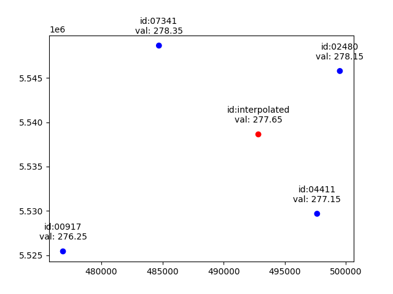
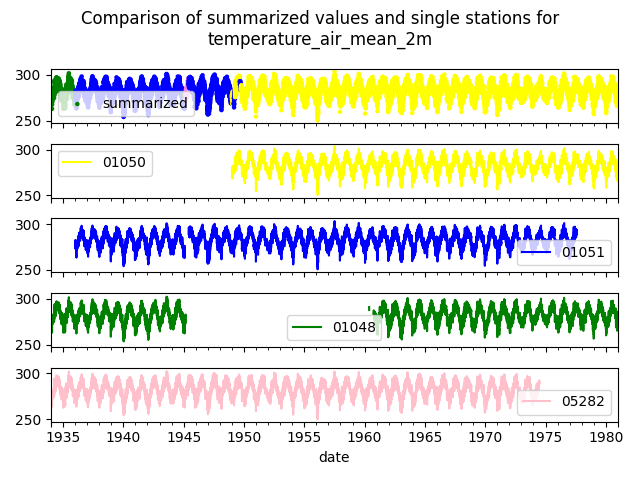

# Interpolation & Summary

Weather stations rarely sit exactly where you need data. Wetterdienst offers two ways to
derive a time series for an arbitrary location from the surrounding station network:

- **Interpolation** — estimate values *at your exact coordinates* by combining the nearest
  stations with a spatial interpolation method. Use this when you want a physically
  plausible value for a point with no station.
- **Summary** — stitch together the *single closest available* station value at each
  timestamp, walking outwards through nearby stations to fill gaps. Use this when you want
  the most complete real-measurement series near a location, rather than a computed blend.

Both features work with the observation request of any provider, not only DWD's (see
[Supported parameters](#supported-parameters)), and require the `interpolation`
extra (`scipy`, `shapely`, `utm`):

```bash
pip install "wetterdienst[interpolation]"
```

## Interpolation

The interpolation feature leverages the four closest stations to your specified latitude
and longitude and employs the bilinear interpolation method provided by the scipy package
to interpolate the given parameter values.

The graphic below shows values of the parameter ``temperature_air_mean_2m`` from multiple
stations measured at the same time. The blue points represent the position of a station and
include the measured value. The red point represents the position of the interpolation and
includes the interpolated value.



Values represented as a table. The figure and the table are an illustration of a request for the daily mean air
temperature of 2022-01-02 at 50.0 N, 8.9 E. They are in kelvin, as the library returned temperatures when they were
made, and their readings are not those the DWD files hold today: the default unit is `degree_celsius` now (see
[Units](units.md)), and the same request answers `8.2`, `7.9`, `8.2` and `7.6` for the stations 02480, 04411, 07341 and
00917 and `8.0` for the interpolated value. The illustration:

| station_id | resolution | dataset         | parameter               | timestamp                 | value  |
|------------|------------|-----------------|-------------------------|---------------------------|--------|
| 02480      | daily      | climate_summary | temperature_air_mean_2m | 2022-01-02 00:00:00+00:00 | 278.15 |
| 04411      | daily      | climate_summary | temperature_air_mean_2m | 2022-01-02 00:00:00+00:00 | 277.15 |
| 07341      | daily      | climate_summary | temperature_air_mean_2m | 2022-01-02 00:00:00+00:00 | 278.35 |
| 00917      | daily      | climate_summary | temperature_air_mean_2m | 2022-01-02 00:00:00+00:00 | 276.25 |

The interpolated value looks like this:

| resolution | dataset         | parameter               | timestamp                 | value  |
|------------|-----------------|-------------------------|---------------------------|--------|
| daily      | climate_summary | temperature_air_mean_2m | 2022-01-02 00:00:00+00:00 | 277.65 |

Pass your target coordinates as `latlon` to `.interpolate()`:

```{code-cell}
---
mystnb:
  number_source_lines: true
---
import datetime as dt
from wetterdienst.provider.dwd.observation import DwdObservationRequest

request = DwdObservationRequest(
    parameters=("hourly", "temperature_air", "temperature_air_2m"),
    start=dt.datetime(2022, 1, 1),
    end=dt.datetime(2022, 1, 20),
)
values = request.interpolate(latlon=(50.0, 8.9))
df = values.df
df
```

Instead of a latlon you may alternatively use an existing station id for which to
interpolate values in a manner of getting a more complete dataset:

```{code-cell}
---
mystnb:
  number_source_lines: true
---
import datetime as dt
from wetterdienst.provider.dwd.observation import DwdObservationRequest

request = DwdObservationRequest(
    parameters=("hourly", "temperature_air", "temperature_air_2m"),
    start=dt.datetime(2022, 1, 1),
    end=dt.datetime(2022, 1, 20),
)
values = request.interpolate_by_station_id(station_id="02480")
df = values.df
df
```

### Which stations an answer was made from

The stations an answer is made from can differ from one timestamp to the next: one has a gap, another stops
reporting for good, a nearby one answers on its own when it has a reading and the stations around the point take
over when it has not. So every row says which stations it was made from, and the stations are listed once, with how
far they are:

| Where | Interpolation | Summary |
|-------|---------------|---------|
| Every row | `taken_station_ids`, the stations the value was calculated from, and `distance_mean`, the mean of their distances in km | `taken_station_id`, the station the value was taken from, and its `distance` in km |
| The stations, each once | `distance` in km, and `elevation_difference` in m | the same |

The stations of a row are the ones that gave a value at its timestamp and went into the answer, not the ones that
were candidates: a station with no reading at that timestamp is not in the row, however near it is. A row made from
one station only is a nearby station, within `geo_use_nearby_station_distance`, that answered alone: an
interpolation is made from four stations otherwise. A row with no value names no station. A summary takes the
first reading of the nearest station that has one, and a row names that station.

The stations that are listed are those some row was made from, and each is listed once, however many rows name it,
so the list does not grow with the length of the window. Ask for them with `with_stations=true` (REST API and
MCP), `--with-stations` (command line) or read `result.stations.df` (Python), and look the stations of a row up by
their ids. An interpolation for 50.0 N, 8.9 E at 450 m, in which the nearby station 00001 reports at 00:00 and 03:00
only, and no station reports at 04:00:

```json
{
  "stations": [
    {"station_id": "00001", "latitude": 50.003, "longitude": 8.9, "elevation": 460.0, "name": "Station 00001",
     "distance": 0.33, "elevation_difference": -10.0},
    {"station_id": "00002", "latitude": 49.97, "longitude": 8.855, "elevation": 100.0, "name": "Station 00002",
     "distance": 4.63, "elevation_difference": 350.0}
  ],
  "values": [
    {"timestamp": "2021-02-01T00:00:00.000000+00:00", "value": 5.065, "distance_mean": 0.33,
     "taken_station_ids": ["00001"]},
    {"timestamp": "2021-02-01T01:00:00.000000+00:00", "value": 5.9844, "distance_mean": 4.77,
     "taken_station_ids": ["00002", "00003", "00004", "00005"]},
    {"timestamp": "2021-02-01T04:00:00.000000+00:00", "value": null, "distance_mean": null,
     "taken_station_ids": []}
  ]
}
```

The mean distance of a row is the mean of the distances its stations are listed with, to rounding. (Abridged: four
more stations, the members every row and station has, and the other rows.)

`distance` is how far the station is from the point asked about, or from the station named as the point, in km: the
number the distances of the rows are made of. The stations frame has a row for each resolution and dataset a station
is listed for, as ever, and a station several of them list has the same distance in each.

**Elevation.** With an `elevation`, a station's reading of a quantity that falls with height (the parameter
glossary says which, and at what rate) is brought to that elevation before it is used, see
[Elevation](#elevation). `elevation_difference` is the elevation asked about less the station's own, in metres, so
that a station 350 m below the point has its air temperature lowered by 350 m times the rate (0.65 K per 100 m),
and one above it raised. It is null without an elevation, when nothing was corrected, and for a station whose
elevation is not known (a quantity that falls with height leaves such a station out). The other quantities are not
corrected whatever it says. The correction itself is not reported per row: it is the same for every row of a
station, so it follows from the station's difference and the rate.

**Files.** A CSV, a spreadsheet or another file of the rows holds no list of records, so it holds what the rows
have: a station id, or the ids of an interpolation joined by commas in one field (`00002,00003,00004,00005`), and
the distance. The distances of the stations are in the table of the stations, which the result writes as a file of
its own: `result.stations.to_csv()` or `result.stations.to_target(...)`, with the `distance` and
`elevation_difference` columns. JSON and GeoJSON hold both, the GeoJSON in the `stations` of the feature.

### Supported parameters

Interpolation is only meaningful for parameters whose fields vary smoothly in space. Which
parameters those are is declared per parameter in the
[parameter glossary](../data/parameters.md), which says for each name whether it can be
interpolated and out of how far stations may be drawn, which follows from how strongly the
quantity is correlated in space — see [the search radius](#the-search-radius) below.

Parameters that are not interpolated at all are those with no meaningful value between two
stations: coded observations such as weather type or cloud genus, quality flags and counts,
quantities tied to one body of water such as discharge or stage, a station's own measurement
errors, and directions — interpolating 350° and 10° linearly would give south.

For the zero-inflated parameters — precipitation and fresh snow, which are zero whenever
nothing fell — interpolation additionally thresholds on occurrence: the value is set to zero
unless at least half of the surrounding stations recorded something, so that a station with
rain and a station without do not average into a drizzle that fell nowhere.

### Elevation

Air temperature falls with height — about 0.65 K per 100 m, a dew point about 0.2 — so stations at
different altitudes say different things about the same weather. Interpolating them as they come
fits that vertical difference as though it were horizontal: around Garmisch the stations within
40 km span 630 m to 2956 m, which is 15 K of it, and around Frankfurt, with the Taunus beside the Main,
they span 100 m to 822 m, or 4.7 K.

Give the point an elevation in metres above sea level and each station's readings are brought to it
before they are used:

```python
request.interpolate(latlon=(47.48, 11.06), elevation=1500)   # on the mountain
request.interpolate(latlon=(47.48, 11.06), elevation=200)    # in the valley
```

`summarize` takes the same argument, where it matters more still: a summary answers with one
station's reading rather than a blend, so nothing softens the difference in altitude.

`interpolate_by_station_id` and `summarize_by_station_id` answer at the named station's own
altitude unless told another one. Naming a point by a station names its elevation as well, and it is
the one case where the elevation is known without being given. For the reading uncorrected, pass
the station's coordinates to `interpolate` instead.

Which quantities are corrected is declared per parameter, alongside whether it can be interpolated
at all: the air temperatures measured at 2 m and the dew point. Not the readings taken at 5 or
10 cm, which are made in the air but governed by the ground radiating beneath them, nor anything
measured in or on the ground, nor pressure, which falls exponentially rather than linearly. A
station whose own elevation the provider does not report is left out of an answer about an elevation
rather than contributing at its own altitude while its neighbours are moved. So is a station of
`noaa/ghcn` whose elevation is 0.0: GHCN writes 0.0 for a station it knows no elevation of (54 of
its 271 hourly stations at 0.0 stand between 150 and 4,329 m), so an elevation of exactly 0.0 is
none there, unless the other resolution's list of the station, where the request names both, gives
a height. A station named as the point (`*_by_station_id`) at 0.0 asks without an elevation. The
stations frame keeps the 0.0 as GHCN writes it, and a 0.0 of any other provider, a coast, is a
height like any other.

Where that leaves a parameter with no station at all — every station of a few providers reports no
elevation, FMI's, IPMA's and the Environment Agency's among them — the request is refused rather
than answered empty, and `NoStationsWithElevationError` names it. Where every quantity asked for
falls with height, enough stations stand near the point for their elevations to have mattered, and
none of them reports one, that much is settled off the station list alone, without downloading a
reading. Ask for such a quantity beside one that does not fall with height and the readings are
fetched for the second, the first being named once the answer is in.

A parameter that kept some stations and still answered nothing is named in the log rather than
raised. Whether the stations it lost would have completed the four an interpolation wants is not
something a count can say — they may not have surrounded the point either — and the readings that
are there stay with the caller either way.

Asking by coordinates and without an elevation takes each station's readings as they came. A request
named by a station id answers at that station's own elevation, so it has no form that asks about no
elevation at all: pass the station's coordinates to `interpolate` for that. Over the REST API both
endpoints report the refusal as a 400, and the CLI prints it without a traceback.

Left out, nothing is corrected. The elevation cannot be taken from the stations themselves: one
derived from the same linear interpolation cancels out of the correction exactly, leaving the
result unchanged, so it has to come from the caller.

### The search radius

How far a station may sit from the target point to still be used depends on how quickly the
quantity decorrelates in space, so two radii carry that decision:

| Option                                  | Default | Applies to                                                                                                                                                                    |
|-----------------------------------------|---------|-------------------------------------------------------------------------------------------------------------------------------------------------------------------------------|
| `geo_station_distance_homogeneous`      | 40 km   | quantities that vary slowly across a region: air, soil, concrete, dew-point, wet-bulb and surface temperatures, humidity, wind speed and gust, air pressure, cloud cover, sunshine and radiation, soil moisture, evapotranspiration and evaporation, accumulated snow depth and the forecast probabilities |
| `geo_station_distance_heterogeneous`    | 20 km at hourly resolution | quantities that decorrelate within a few tens of kilometres: precipitation in all its variants, new snow per period and visibility |

Which of the two a parameter belongs to is declared per parameter; the
[parameter glossary](../data/parameters.md) names the radius for every parameter. Changing a
radius moves every parameter of its kind at once. They are options of the request, given as
`options=Options(...)` or as a dict:

```python
from wetterdienst import Options

# reach further for the smooth fields, and keep precipitation closer than the default 20 km
options = Options(
    geo_station_distance_homogeneous=60.0,
    geo_station_distance_heterogeneous=15.0,
)
```

Single parameters are overridden on top of the two, keyed by canonical parameter name:

```python
options = Options(geo_station_distance={"precipitation_amount": 25.0})
```

All three are settable from the environment as well, as any other option is; the variables keep
their `WD_TS_` prefix:

```bash
export WD_TS_GEO_STATION_DISTANCE_HOMOGENEOUS=60
export WD_TS_GEO_STATION_DISTANCE_HETEROGENEOUS=15
export WD_TS_GEO_STATION_DISTANCE='{"precipitation_amount": 25}'
```

A key that is not a canonical parameter is rejected rather than kept and never read, so a typo no
longer leaves the parameter you meant at its default radius without saying so, and a negative
distance is rejected too. A radius set for a parameter that is never interpolated is a warning: the
name is real, but interpolation skips the parameter before the distance is ever compared.

A name that was renamed in one dataset only (`wind_speed`, which is `wind_speed_mean_last_10min` in
the hourly data of several providers) is still a canonical parameter of the datasets that keep it,
so it is accepted as a key and sets the radius of those. Key the new name to set the radius of the
renamed parameter.

#### The heterogeneous radius follows the resolution

A quantity that decorrelates fast in space does so less the longer it is accumulated. Gauge studies
put the correlation length of precipitation at roughly 8 km over ten minutes, 27 km over three
hours and 33 to 94 km over a day, the upper end for the stratiform rain that dominates
north-western Europe. One number cannot serve both ends of that, so the heterogeneous radius is
multiplied by a factor that depends on the resolution of the request:

| Resolution                                            | Factor | Radius |
|-------------------------------------------------------|--------|--------|
| `1_minute`, `5_minutes`, `6_minutes`, `10_minutes`, `15_minutes` | 0.75   | 15 km  |
| `hourly`                                              | 1.0    | 20 km  |
| `6_hours`, `subdaily`                                  | 1.5    | 30 km  |
| `daily`                                               | 2.0    | 40 km  |
| `monthly`, `annual`                                   | 2.0    | 40 km  |

The table stops widening at 2.0 rather than following the correlation length up. Past a day, what
binds is terrain and not correlation: `apply_interpolation` works on UTM x/y and never reads station
elevation, so 40 km is as far as it may reach in complex ground. That is the same bound the
homogeneous radius is held to, which is why the two meet at `daily` with the defaults --
precipitation is more orographically driven than temperature, not less, so it does not get to reach
farther.

The homogeneous radius does not scale at all. Terrain does not care how long a quantity was
accumulated for, and daily temperature stays correlated over hundreds of kilometres either way.

The fine end stops short of the correlation length on purpose: interpolation needs four surrounding
stations, and even the DWD network rarely has four rain gauges within 8 km of a point, so 15 km is
as tight as still answers at all.

The factors are an option like the radii are, keyed by resolution:

```python
options = Options(geo_station_distance_resolution_factors={"10_minutes": 1.0})
```

```bash
export WD_TS_GEO_STATION_DISTANCE_RESOLUTION_FACTORS='{"10_minutes": 1.0}'
```

That one searches the full 20 km at ten minutes rather than 15.

Resolutions left out keep their factor, so the option stays the list of departures rather than all
eleven, and a resolution that does not exist is rejected the way an unknown parameter name is.
Setting every factor to 1.0 turns the scaling off.

The factors are plain multipliers of `geo_station_distance_heterogeneous`, so every kilometre
added to that option moves every resolution with it: raise it to 30 km and the table reads 22.5,
30, 45, 60. Nothing clips it back. The terrain bound the factors encode is a judgement about the
default radius, and a user who changes that radius has made their own.

The factors are set in Python or in the environment only. The two radii and the per-parameter
overrides are also options of the CLI and the REST API, as shown below, but the factors have no
flag or query parameter there.

To ask what a request will actually use, rather than reading it off the table:

```{code-cell}
---
mystnb:
  number_source_lines: true
---
from wetterdienst import Options

options = Options()
{
    resolution: options.geo_station_distance_for("precipitation_amount", resolution)
    for resolution in ("10_minutes", "hourly", "6_hours", "daily", "monthly")
}
```

The same question for a homogeneous parameter answers 40 km at every resolution, and for a
parameter that is never interpolated the radius is never consulted at all.

To turn the scaling off altogether, flatten every factor:

```{code-cell}
---
mystnb:
  number_source_lines: true
---
from wetterdienst.metadata.resolution import Resolution

flat = Options(
    geo_station_distance_resolution_factors=dict.fromkeys((resolution.value for resolution in Resolution), 1.0),
)
{
    resolution: flat.geo_station_distance_for("precipitation_amount", resolution)
    for resolution in ("10_minutes", "hourly", "daily")
}
```

A radius written out per parameter in `geo_station_distance` is used exactly as given, at every
resolution -- a number you wrote means that number.

```{note}
Tightening the fine end is the one direction that can turn a request that used to answer into an
empty one: the interpolation needs four surrounding stations, and 15 km may not reach four of them
in a sparse network. The log says which stations were dropped as too far away; raising the factor
for that resolution, or the radius for that parameter, brings them back.
```

```{note}
`Options` are frozen: assigning to one of them raises an error, and `options.replace(...)` gives a
changed copy that is validated as a new instance is, the two radii, the factors and the
per-parameter `geo_station_distance` alike. A request takes its options when it is constructed --
a dict is validated then, not when `.interpolate()` or `.summarize()` is called, and an `Options`
object it is handed is used as it is -- so build the request with the options you want.
```

The example below widens the radius for precipitation to 25 km:

```{code-cell}
---
mystnb:
  number_source_lines: true
---
import datetime as dt
from wetterdienst import Options
from wetterdienst.provider.dwd.observation import DwdObservationRequest

options = Options(geo_station_distance={"precipitation_amount": 25.0})
request = DwdObservationRequest(
    parameters=("hourly", "precipitation", "precipitation_amount"),
    start=dt.datetime(2022, 1, 1),
    end=dt.datetime(2022, 1, 20),
    options=options,
)
values = request.interpolate(latlon=(52.8, 12.9))
df = values.df
df
```

### Other options

Three more options control which stations are drawn on (see also the
[options](settings.md#options) chapter):

| Name                            | Type  | Default | Description                                                                                                            |
|---------------------------------|-------|---------|------------------------------------------------------------------------------------------------------------------------|
| geo_use_nearby_station_distance | float | 1.0     | Distance (in km) up to which a nearby station's value is used directly instead of interpolating. Not read by a summary. |
| geo_min_gain_of_value_pairs     | float | 0.1     | Minimum gain of value pairs for an additional station to be included, to avoid using every station in a dense network.  |
| geo_num_additional_stations     | int   | 3       | Number of additional stations used regardless of the gain, to guarantee a minimum number of stations.                   |

Interpolation is still in its early stages, we welcome feedback to enhance and refine its
functionality.

## Summary

Similar to interpolation you may sometimes want to combine multiple stations to get a
complete list of data. For that reason you can use `.summarize(latlon)`, which walks
through the nearest stations and combines their data meaningfully. The figure below shows
the summarized values of the parameter ``temperature_air_mean_2m`` from multiple stations.



It works with the observation request of any provider, and for individual parameters. It supports
the same parameters as interpolation, listed in the
[parameter glossary](../data/parameters.md), and decides whether a station is close enough by
[the search radius](#the-search-radius) above, resolution scaling and all. The scaling is about how
far a measurement still says something about the target point, which is the same question here even
though nothing is blended: a daily total from 35 km away represents a place far better than a
ten-minute total from the same station does. So a daily summary reaches further than an hourly one,
and a summary at ten minutes stays closer than it used to.

```{code-cell}
---
mystnb:
  number_source_lines: true
---
import datetime as dt
from wetterdienst.provider.dwd.observation import DwdObservationRequest

request = DwdObservationRequest(
    parameters=("hourly", "temperature_air", "temperature_air_2m"),
    start=dt.datetime(2022, 1, 1),
    end=dt.datetime(2022, 1, 20),
)
values = request.summarize(latlon=(50.0, 8.9))
df = values.df
df
```

Instead of a latlon you may alternatively use an existing station id for which to summarize
values in a manner of getting a more complete dataset:

```{code-cell}
---
mystnb:
  number_source_lines: true
---
import datetime as dt
from wetterdienst.provider.dwd.observation import DwdObservationRequest

request = DwdObservationRequest(
    parameters=("hourly", "temperature_air", "temperature_air_2m"),
    start=dt.datetime(2022, 1, 1),
    end=dt.datetime(2022, 1, 20),
)
values = request.summarize_by_station_id(station_id="02480")
df = values.df
df
```

A row of a summary names the station its value was taken from (`taken_station_id`, with its `distance`), and
the stations are listed with their distance and elevation difference as for an interpolation, see
[Which stations an answer was made from](#which-stations-an-answer-was-made-from). As the first station with a
reading is taken for each timestamp, a series may be stitched together from several stations: the stations that are
listed are those some row was taken from, and a station nearer than another that has no reading at a timestamp is
passed over for it.

Summary is still in its early stages, we welcome feedback to enhance and refine its
functionality.

## Command line

Both features are also available as CLI commands. The reference location is given either by
`--station` (a station id) or by `--latitude`/`--longitude`:

```bash
# Interpolate to a coordinate.
wetterdienst interpolate \
  --provider dwd --network observation \
  --parameters hourly/temperature_air/temperature_air_2m \
  --latitude 50.0 --longitude 8.9 \
  --start 2022-01-01 --end 2022-01-20

# Summarize around a reference station.
wetterdienst summarize \
  --provider dwd --network observation \
  --parameters hourly/temperature_air/temperature_air_2m \
  --station 02480 \
  --start 2022-01-01 --end 2022-01-20
```

Both take `--elevation` in metres above sea level, which brings each station's readings to that
elevation before they are used:

```bash
wetterdienst interpolate \
  --provider dwd --network observation \
  --parameters daily/kl/temperature_air_mean_2m \
  --latitude 47.48 --longitude 11.06 --elevation 1500 \
  --start 2022-01-01 --end 2022-01-05
```

Both commands take the search radius as options, `--interpolation-station-distance-homogeneous`
and `--interpolation-station-distance-heterogeneous` (`--summary-…` for `summarize`), with
`--interpolation-station-distance` overriding single parameters as a JSON object:

```bash
wetterdienst interpolate \
  --provider dwd --network observation \
  --parameters hourly/precipitation/precipitation_amount \
  --latitude 52.8 --longitude 12.9 \
  --start 2022-01-01 --end 2022-01-20 \
  --interpolation-station-distance-heterogeneous 30 \
  --interpolation-station-distance '{"precipitation_amount": 25}'
```

`summarize` takes the same three under `--summary-…`:

```bash
wetterdienst summarize \
  --provider dwd --network observation \
  --parameters daily/climate_summary/precipitation_amount \
  --station 02480 \
  --start 2022-01-01 --end 2022-01-20 \
  --summary-station-distance-heterogeneous 15
```

A summary takes the nearest station with data anyway, so it has no `use-nearby-station-distance`
option: that of interpolation is the only one, and `summarize` refuses it as an unknown option or
parameter.

An option that is left out keeps whatever the environment and the defaults say, so a radius set
through `WD_TS_GEO_STATION_DISTANCE_HETEROGENEOUS` is not overwritten by the command. The
resolution factors are not command options -- they are set in Python through `options=`, or in the
environment, as above.

## REST API

When the [REST API](restapi.md) is running, use the `/api/interpolate` and `/api/summarize`
endpoints (examples use [httpie](https://github.com/httpie/cli)):

```bash
# Interpolate to a coordinate.
http localhost:7890/api/interpolate \
  provider==dwd network==observation \
  parameters==hourly/temperature_air/temperature_air_2m \
  latitude==50.0 longitude==8.9 \
  timestamp==2022-01-01/2022-01-20

# Summarize around a reference station.
http localhost:7890/api/summarize \
  provider==dwd network==observation \
  parameters==hourly/temperature_air/temperature_air_2m \
  station==02480 \
  timestamp==2022-01-01/2022-01-20
```

The values of both are selected or calculated by wetterdienst from the readings of one or more stations, and the
`metadata` of the answer says so: its `processing_note` adds "The values were selected or calculated from the
provider's readings." to the note every answer has (see
[response metadata](restapi.md#response-metadata)), so a licence that asks for changes to be indicated has them said.

`with_stations=true` adds the `stations` the values were made from, each with its `distance` from the point and its
`elevation_difference` (see [Which stations an answer was made from](#which-stations-an-answer-was-made-from)); the
rows name them either way. The command line has `--with-stations`, and the MCP tools take `with_stations` as the
endpoints do.

The radii are query parameters of their own, again per request rather than per server:

```bash
http localhost:7890/api/interpolate \
  provider==dwd network==observation \
  parameters==hourly/precipitation/precipitation_amount \
  latitude==52.8 longitude==12.9 \
  timestamp==2022-01-01/2022-01-20 \
  interpolation_station_distance_heterogeneous==30 \
  interpolation_station_distance=='{"precipitation_amount": 25}'
```

`/api/summarize` takes the same three under `summary_…`. A parameter name that is not canonical is
answered with a 400 rather than silently ignored, a negative distance with a 422, and the resolution
factors are not query parameters -- an instance scales by its own configuration.

The work of one request is bounded: a distance given is at most 200 km (five times the default of 40 km for a
parameter that varies slowly; the heterogeneous one is scaled by the resolution on top, up to twice),
`num_additional_stations` at most 20 (the default is 3) and `min_gain_of_value_pairs` more than 0, else a 422, and
the stations with a record in the window within the widest radius of the request are held to the limit of stations
of the server (100 by default, see [Limits](restapi.md#limits)), a 400 that names the distance to narrow. The Python
API and the command line take any of these. Everywhere, the search for a group of stations that surrounds the point
looks at the nearest 30 of the stations a parameter has at most (`wetterdienst.core.interpolate.MAX_STATION_GROUPS`), and where
none of their groups surrounds it takes the one group of the triangle the point lies in.
